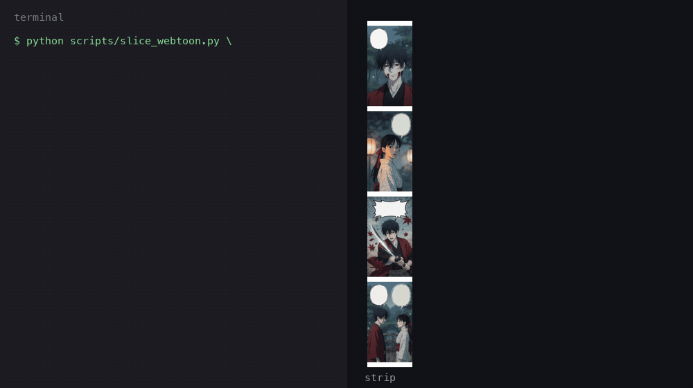

# Manhwa Recap Toolkit

[](https://github.com/tofutoon/manhwa-recap-toolkit/actions/workflows/test.yml)

No Python? Use the [browser version](https://tofutoon.com/tools/webtoon-slicer?utm_source=github&utm_medium=readme&utm_campaign=recap_toolkit).

Free Python scripts and prompts for manhwa and webtoon recap creators. Split tall webtoon images into panels at the blank gutters, renumber chapter pages in natural order (2 before 10), and find subtitle cues too long to read aloud.



## What's inside

| Tool | What it does |
| --- | --- |
| [`scripts/slice_webtoon.py`](scripts/slice_webtoon.py) | Splits a tall webtoon strip into separate images, cutting only in blank gutters between panels, never through art or a speech bubble. |
| [`scripts/renumber_pages.py`](scripts/renumber_pages.py) | Renames page files to `001`, `002` and so on in natural order, so `2.jpg` comes before `10.jpg`. Dry run by default, never overwrites. |
| [`scripts/srt_tight_cues.py`](scripts/srt_tight_cues.py) | Reads an SRT or VTT file and lists the cues with more words than a voice can read in their time window. |
| [`prompts/recap-script-prompt.md`](prompts/recap-script-prompt.md) | A five-rule prompt that turns raw chapter dialogue into third-person recap narration, with a worked example. |
| [`prompts/name-glossary-template.md`](prompts/name-glossary-template.md) | A table for character, place and skill names, so the spelling stays the same across chapters. |
| [`data/edge-tts-voices-2026-11-01.json`](data/edge-tts-voices-2026-11-01.json) | A dated snapshot of 322 Microsoft Edge text-to-speech voices, with locale, gender and style tags. |

## Install

You need Python 3.9 or later. The only dependency is Pillow. Works on Windows, macOS and Linux.

```bash
git clone https://github.com/tofutoon/manhwa-recap-toolkit.git
cd manhwa-recap-toolkit
python -m pip install -r requirements.txt
```

On Windows, use `py` in place of `python` if `python` is not found.

## Usage

### Slice a webtoon strip

```bash
python scripts/slice_webtoon.py examples/strip/moonlit-vow-strip.jpg -o pages
```

```text
moonlit-vow-strip.jpg: 540x4140px -> 4 pages
  001.png  rows 30-1052  (1022px)
  002.png  rows 1052-2068  (1016px)
  003.png  rows 2068-3092  (1024px)
  004.png  rows 3092-4110  (1018px)
Wrote 4 pages to pages
```

- The input can be one image or a folder of images, in natural order. Formats: PNG, JPG and WEBP. Pages are numbered across the whole folder.
- A gutter is at least `--min-gap` rows (default 20 px) of one flat colour: white, black or any other. Each cut goes through the middle of a gutter.
- `--tolerance` (default 8, out of 255) sets how much colour noise a gutter row may have. Raise it for JPG noise or scans.
- `--dry-run` prints the planned cuts and writes nothing.
- `--max-height 4000` splits panels taller than 4,000 px at the flattest row it can find, and prints a warning for each such cut.

### Renumber pages

```bash
python scripts/renumber_pages.py chapter-12/
```

```text
page 1.jpg                               -> 001.jpg
page 2.jpg                               -> 002.jpg
page 10.jpg                              -> 003.jpg
Dry run: 3 files would be renamed. Add --apply to rename.
```

Add `--apply` to rename. The script refuses to run if a new name would overwrite a file that is not part of the rename, and writes `renames.csv` with the old and new names.

### Find tight subtitle cues

```bash
python scripts/srt_tight_cues.py examples/sample.srt
```

```text
  cue  start         words     sec    wps  text
    2  00:00:03,200     18    1.80  10.00  Yuki swears she will follow him, even into deat...
    4  00:00:08,500     12    1.00  12.00  On the rooftop, Kang waits with a drawn sword a...
2 of 4 cues are above 2.5 words per second.
```

The default limit is 2.5 words per second, about 150 words per minute. Set your own with `--wps`, and save the table with `--csv tight.csv`.

### Write a recap script with AI

Open [prompts/recap-script-prompt.md](prompts/recap-script-prompt.md), fill in your names from the [glossary template](prompts/name-glossary-template.md), and paste the prompt and the chapter text into ChatGPT, Gemini, Claude or another model.

### Pick an Edge voice

See [data/README.md](data/README.md) for how the list was made and a one-line filter example.

## Limits

- Gutters must be flat. Art that runs edge to edge with no gap cannot be cut without `--max-height`, and those cuts may go through art.
- A flat area inside a panel, such as a plain sky as wide as the strip, looks like a gutter and may be cut. Raise `--min-gap` if that happens.
- Scanned paper strips have grain and uneven white. Try `--tolerance 20` to `40`.
- The image is decoded once in memory. A 50,000 px tall, 800 px wide strip needs about 120 MB.
- The SRT check counts words only. It does not know the voice, the language or punctuation pauses. Languages written without spaces, such as Chinese or Japanese, are counted as long words, so the check does not fit them.
- The voice list is a snapshot from 2026-11-01. Microsoft changes voices over time.

## Rights

Only use chapters you have the right to use. This toolkit works on files you already have. It does not download or scrape comics, and it never will.

Recap videos also raise copyright questions about the panels and the story. Read [recap videos and copyright](https://tofutoon.com/blog/recap-videos-copyright?utm_source=github&utm_medium=readme&utm_campaign=recap_toolkit) before you upload.

## Want the whole workflow in one app?

[Tofu Image Text](https://tofutoon.com/tools/img2audio?utm_source=github&utm_medium=readme&utm_campaign=recap_toolkit) is a pay-once desktop app for Windows and Apple-silicon Macs (M1 or later). It reads comic pages with OCR on your computer, writes a recap script with your own AI key, and exports TXT, Word or one audio file per chapter. It does not make the video.

Guides:

- [How to make manhwa recap videos](https://tofutoon.com/blog/how-to-make-manhwa-recap-videos?utm_source=github&utm_medium=readme&utm_campaign=recap_toolkit)
- [Manhwa recap script with AI: prompt template and examples](https://tofutoon.com/blog/manhwa-recap-script-ai-prompt?utm_source=github&utm_medium=readme&utm_campaign=recap_toolkit)
- [Comic dub video in CapCut](https://tofutoon.com/blog/comic-dub-video-capcut?utm_source=github&utm_medium=readme&utm_campaign=recap_toolkit)

## License

[MIT](LICENSE). Made by TofuToon.

The sample art in `examples/` (*Moonlit Vow*) was made for TofuToon and is covered by the same license.
